 

 

##  Public

  
  
  
  

##  Lab

  
  

##  사용한 언어

  
  
  
  
  
  

##  git history

<picture>
  <source media="(prefers-color-scheme: dark)" srcset="https://raw.githubusercontent.com/sangwookp9591/sangwookp9591/output/pacman-contribution-graph-dark.svg">
  <source media="(prefers-color-scheme: light)" srcset="https://raw.githubusercontent.com/sangwookp9591/sangwookp9591/output/pacman-contribution-graph.svg">
  
</picture>

 

**함께 만들 게 있다면 편하게 연락 주세요.**

